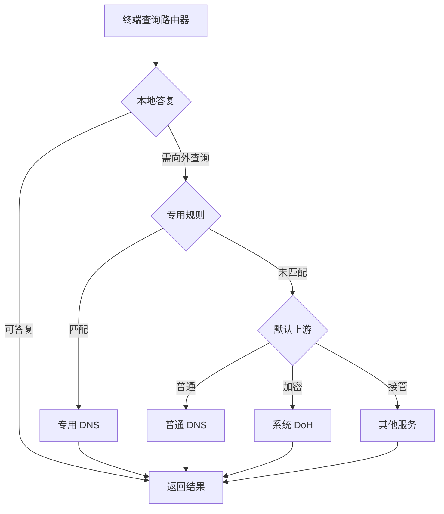
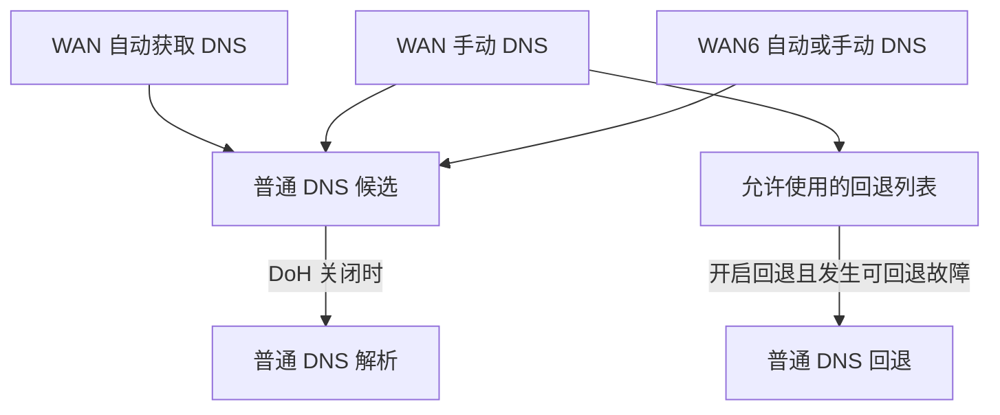
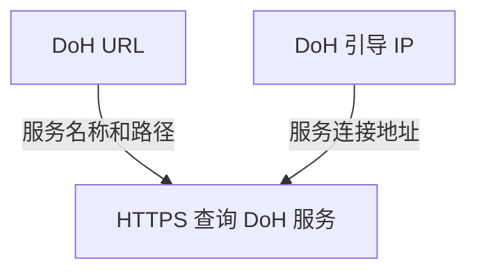
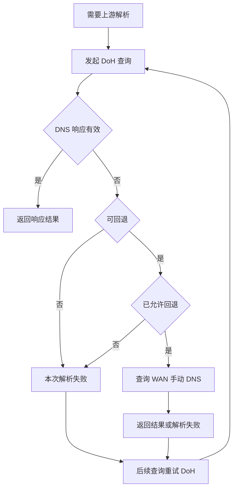

# DNS：解析、加密查询与故障回退

[返回首页](../../README.md) · [功能说明](README.md) · [LAN 与地址分配](lan.md) · [25.12 系统说明](../systems/25.12-6.12.md)

DNS 把网站和服务的域名转换为设备可以连接的地址。本页先解释查询怎样经过路由器，再介绍普通 DNS、DoH、代理接管与恢复方法。

| 功能 | 适用系统 | 设置入口 |
|---|---|---|
| 普通上游 DNS，自动获取或手动指定 | 21.02、24.10、25.12 | 网络 → 接口 → WAN / WAN6 → 编辑 → 高级设置 |
| 系统 DoH 加密查询、回退设置与当前上游列表 | 25.12；DoH 默认关闭 | 网络 → DNS → 加密 DNS |

按需阅读：[基本关系](#dns-basics) · [查询流程](#query-flow) · [普通 DNS](#ordinary-dns) · [IPv6](#ipv6) · [DoH](#doh) · [故障回退](#fallback) · [其他服务](#other-services) · [查看状态](#status) · [排错与恢复](#restore)

<a id="dns-basics"></a>

## DNS、网关和地址分配各管什么

打开一个网站时，设备先取得域名对应的地址，再向这个地址建立连接。DNS 负责前一步；网关负责把需要离开局域网的流量送往外部网络。DHCP 则在设备接入时，把 IP、网关和 DNS 等参数提供给设备，详见 [LAN 与地址分配](lan.md)。

这几种地址可能出现在同一页设置中，用途各不相同：

| 名称 | 它回答的问题 | 默认使用方式 |
|---|---|---|
| 设备 IP | 这台设备在局域网里的地址是什么？ | 由路由器通过 DHCP 分配 |
| 默认网关 | 访问局域网外的地址时，先把数据交给谁？ | 路由器的 LAN 地址 |
| 设备使用的 DNS | 设备把域名查询交给谁？ | 路由器的 LAN 地址，出厂为 `192.168.31.1` |
| 路由器的上游 DNS | 路由器需要向外查询时，再交给谁？ | WAN 自动获取的 DNS；也可手动配置或启用 DoH |

因此，在 WAN 中更换上游 DNS 后，电脑通常仍显示 `192.168.31.1` 为 DNS，这是正常的：电脑继续查询路由器，由路由器使用新的上游。已经修改过 LAN 地址时，设备应使用新的路由器地址。

让设备统一查询路由器，便于集中管理上游、共享缓存，并解析路由器提供的局域网名称。启用系统 DoH 后，沿这条路径查询的设备也能使用加密上游，无需逐台配置 DoH。

<a id="query-flow"></a>

## 一次域名查询怎样完成

终端会先检查自己的缓存；需要向路由器查询时，流程如下。图中的“本地答复”包括局域网名称等本地记录，以及路由器中尚可使用的缓存。终端取得可用地址后，再向目标网站或服务建立连接。



为某个域名指定上游后，匹配该规则的查询使用专用上游，其余查询继续使用默认上游。例如，为内部域名指定内网 DNS，可以让内部名称留在对应网络中解析。

应用自行启用安全 DNS、终端手动填写其他 DNS，或 OpenClash 接管查询时，路径会发生变化，见[与其他服务配合](#other-services)。更换 DNS 后，终端、浏览器和路由器已有的缓存仍可能继续使用；已经建立的网站连接也会继续工作。

<a id="ordinary-dns"></a>

## 设置普通上游 DNS

### 自动获取的 DNS 来自哪里

先找到实际用于上网的接口。如果曾改过接口名称，按协议识别它。

| 上网方式 | 选择的接口 | 自动 DNS 来源 |
|---|---|---|
| PPPoE 宽带拨号 | 协议为 **PPPoE** 的 WAN | 运营商在拨号时提供 |
| DHCP 自动获取地址 | 协议为 **DHCP 客户端** 的 WAN | 光猫、上级路由器或接入网络通过 DHCP 提供 |

WAN 通过 DHCP 连接光猫时，DNS 可能指向光猫，也可能是光猫下发的其他服务器。需要自行选择上游时，在路由器中改为手动 DNS 即可，无需关闭光猫的 DNS 服务。

### 改为手动 DNS

1. 打开 **网络 → 接口 → WAN → 编辑 → 高级设置**。
2. 取消 **自动获取 DNS 服务器**。
3. 在随后显示的 **使用自定义的 DNS 服务器** 中填写所选服务器的 IP 地址，每项一个。
4. 点击 **保存并应用**。电脑和手机继续自动获取 DNS 即可。

这里填写普通 DNS 的服务器 IP，使用 UDP/TCP 53；DoH 的 `https://` 地址在[加密 DNS 页面](#doh)填写。

修改 DNS 时保留原有上网协议和 **使用默认网关** 设置。PPPoE 的账号密码无需更改；DHCP 仍会自动获取 WAN 地址和网关。应用 WAN 设置可能短暂中断上网，请选择方便操作的时间。

<a id="ipv6"></a>

## 同时使用 IPv6 时怎样设置

普通 DNS 模式下，WAN 与 WAN6 提供的 DNS 可以共同参与解析。希望统一使用自己选择的服务器时，需要同时检查 IPv4、IPv6 接口的来源。

| IPv6 接口 | 设置方法 |
|---|---|
| PPPoE 自动生成的 `wan_6`，页面标记为动态接口 | 在 WAN 关闭 **自动获取 DNS 服务器** 后，下次重新拨号时，`wan_6` 也会停止使用运营商提供的 DNS，无需单独编辑它。保存后若仍有旧 DNS，可在方便短暂断网时重新连接 WAN。 |
| 单独配置的 WAN6，协议为 **DHCPv6 客户端** | 进入该接口的 **编辑 → 高级设置**，取消 **自动获取 DNS 服务器**。可以填写自己的 DNS；若 WAN 已提供可用上游，也可以留空，让路由器使用 WAN 提供的上游。 |

DNS 服务器的地址类型与查询结果的类型是两件事：IPv4 地址的 DNS 可以回答 IPv6 地址记录（AAAA），IPv6 地址的 DNS 也可以回答 IPv4 地址记录（A）。因此，查询 A 或 AAAA 记录并不会分别指定使用 WAN 或 WAN6 的 DNS。

修改 DNS 无需关闭 IPv6。LAN 默认关闭 IPv6 发布，WAN IPv6 则可独立配置；向局域网设备提供 IPv6 地址和 DNS 的设置属于 [LAN 配置](lan.md)。

<a id="doh"></a>

## 配置加密 DNS（DoH）

DoH 通过 HTTPS 加密路由器向上游发送的 DNS 查询。局域网设备仍可向路由器发送普通 DNS 查询，再由路由器通过 HTTPS 查询 DoH 服务；本地记录和缓存直接返回。

加密的是**路由器到 DoH 上游**这一段。局域网设备到路由器的普通 DNS、为指定域名设置的其他上游，以及代理或应用自行处理的查询，分别沿各自的路径工作。

打开 **网络 → DNS → 加密 DNS**。上方设置 DoH，下方查看当前上游及其来源。WAN 使用 DHCP 连接光猫或使用 PPPoE 拨号，都可以开启；普通 DNS 自动获取开关可以保持原来的选择。

### URL、引导 IP 和普通 DNS 为什么分开填写

| 选项 | 用途与填写方法 |
|---|---|
| **DoH 服务器 URL** | 服务商提供的完整 `https://` 地址，包含服务路径。支持域名、IPv4 或方括号内的 IPv6 地址。 |
| **DoH 引导 IP 地址** | 用于连接这台 DoH 服务器，每项一个，从服务商获取。URL 使用域名时必填；URL 直接使用 IP 时可留空。 |
| **允许回退到普通 DNS** | 默认关闭。开启后，遇到可回退的 DoH 故障时使用允许的普通 DNS；这些查询不加密。具体选择见[故障回退](#fallback)。 |

域名形式的 URL 同时说明要访问的服务名称和请求路径；引导 IP 告诉路由器从哪个地址连接它。路由器直接连接引导 IP，并按 URL 中的域名验证 HTTPS 证书，从而无需先向普通 DNS 查询 DoH 服务端的地址。

引导 IP 不是给网站查询准备的普通 DNS。除非服务商明确说明同一地址同时提供两种服务，否则应分别填写。使用纯 IP URL 时，服务商需要提供匹配该 IP 的 HTTPS 证书。系统时间也要正确，否则证书有效期检查可能失败。本页支持 DoH，DoT 的 `tls://` 地址不适用于此处。

普通 DNS 与回退地址来自接口设置：



DoH 的连接参数单独配置，URL 与引导 IP 一起确定连接的服务：



### 开启步骤

1. 打开 **使用 DNS over HTTPS**，填写服务商提供的完整 URL。
2. URL 使用域名时，填写该服务的 **DoH 引导 IP 地址**；使用纯 IP URL 时按服务商要求配置。
3. 选择是否 **允许回退到普通 DNS**。需要回退时，先在 WAN 中[手动填写普通 DNS](#ordinary-dns)，再核对本页列出的回退目标。
4. 点击 **保存并应用**，在下方 **当前上游 DNS** 查看[生效状态](#status)。

<a id="fallback"></a>

## 选择严格加密还是允许普通 DNS 回退

DoH 服务暂时不可达时，可以优先保持加密，也可以允许使用普通 DNS 继续解析。

| 选择 | 故障时的行为 | 适合的需求 |
|---|---|---|
| 关闭 **允许回退到普通 DNS** | 需要经 DoH 向外查询的域名暂时无法解析，随后会重试 DoH。可用的本地记录与缓存仍能回答。 | 希望系统默认查询保持加密 |
| 开启 **允许回退到普通 DNS** | 遇到可回退故障时，使用允许的普通 DNS，并在之后重试 DoH。回退查询不加密。 | 希望 DoH 服务故障时仍有备用解析方式 |

**回退只使用 WAN 手动填写的 DNS。** WAN6、DHCP/PPPoE 自动获取的地址，以及 DoH 引导 IP 都不会自动加入回退列表。没有有效的 WAN 手动 DNS 时，需先填写再开启回退。只需要 DoH、不需要普通 DNS 回退的用户，可以继续让 WAN 自动获取普通 DNS。

回退针对网络连接、TLS、无效响应、限流或服务端故障。收到有效 DNS 响应时，会按响应处理：例如“域名不存在”（NXDOMAIN）、没有所问类型的记录（NODATA），以及服务器返回的 SERVFAIL、REFUSED，都不会仅因“没查到地址”就改用普通 DNS。HTTP 401/403 等认证或策略拒绝也应检查服务配置。



发生回退后，检查上网连接、DoH URL、引导 IP 和系统时间。DoH 恢复可用后，后续查询会重新使用加密上游；无需为了恢复而来回切换开关。

<a id="other-services"></a>

## 与 OpenClash、终端和浏览器 DNS 配合

同一台设备可能同时存在路由器 DNS、代理 DNS 和浏览器安全 DNS。判断应在哪里修改设置，先看查询由谁处理。

| 使用方式 | 查询怎样处理 | 在哪里设置 |
|---|---|---|
| 终端自动获取 DNS，并使用路由器 DNS | 路由器先处理本地记录和缓存，需要向外查询时使用系统上游。 | 普通 DNS 在 WAN/WAN6 高级设置；系统 DoH 在加密 DNS 页面。 |
| 为指定域名配置专用上游 | 匹配的查询使用专用上游，其余使用默认上游。 | 对应的 DNS 转发规则。 |
| OpenClash 接管默认 DNS | 系统将相关查询交给 OpenClash，由它选择上游。 | OpenClash 的 DNS 设置。 |
| OpenClash 通过 TUN 或重定向接管查询 | 查询进入代理的处理路径。 | OpenClash 的接管方式和 DNS 设置。 |
| 终端手动填写其他普通 DNS | 终端向所填地址发起查询；若存在 DNS 重定向或代理接管，实际路径会随之改变。 | 同时检查终端 DNS、路由器重定向和代理设置。 |
| 浏览器或应用单独启用安全 DNS | 应用使用自己的解析设置，可能绕过系统 DNS。 | 浏览器或应用的安全 DNS 设置。 |

OpenClash 或自定义全局上游接管默认解析后，系统 DoH 会让出这部分转发。需要由系统统一解析时，停用对应接管并恢复系统 DNS；路由器随后按当前开关使用 DoH 或普通 DNS。若仍显示其他转发设置优先，检查是否留有自定义上游。

需要浏览器和其他设备一起使用路由器 DNS 时，关闭浏览器或应用的独立安全 DNS，并让终端自动获取 DNS。随后检查 DNS 重定向、代理接管和终端缓存，确认查询走预期路径。

<a id="status"></a>

## 查看当前使用的上游

在 **网络 → DNS → 加密 DNS** 中，上方状态说明默认 DNS 的处理方式，下方 **当前上游 DNS** 列出服务器地址、协议、来源、用途与状态。

| 页面状态 | 含义与操作 |
|---|---|
| **DoH 已纳入默认转发** | 默认上游已切换为 DoH。 |
| **DoH 不可用，已发生普通 DNS 回退** | 查询已回退到允许的普通 DNS。检查上网连接、DoH 地址、引导 IP 和系统时间。 |
| **DNS 查询暂不可用** | 检查上网连接、服务器地址和系统时间；需要先恢复解析时，可[关闭 DoH](#restore)使用普通 DNS。 |
| **当前 DNS 转发设置优先，未使用系统 DoH** | 默认查询由应用或自定义转发设置处理，到对应设置中管理 DNS。 |
| **已应用的 DoH 配置无效** | 核对 URL、引导 IP，以及启用回退时的 WAN 手动 DNS，然后重新保存并应用。 |

| 列表状态 | 含义 |
|---|---|
| **已纳入转发** | 已用于当前转发配置的上游。 |
| **当前未参与** | 已配置或自动获取，当前默认路径没有使用。 |
| **回退备用** | DoH 发生可回退故障时允许使用的普通 DNS。 |
| **其他服务处理** | 查询交给其他 DNS 服务；其上游在对应应用中设置。 |

同一个 DNS 地址来自 WAN、WAN6 等多个接口时，会合并为一行并显示全部来源。来源说明地址从哪里得到；是否参与当前转发，则由用途和状态说明。一个地址即使同时来自 WAN6，只要也在 WAN 手动列表中，仍可以作为允许的回退目标。

DoH 关闭时，WAN/WAN6 的普通 DNS 可共同参与；DoH 生效后，普通 DNS 按设置显示为 **回退备用** 或 **当前未参与**。指定域名的专用转发规则在列表下方单独查看。

修改设置后先 **保存并应用**，再点击 **刷新** 更新列表。列表用于查看当前转发安排；判断一次查询是否成功，可按下节的方法检查。读取失败时查看状态更新时间，稍后刷新重试；刷新不会应用尚未保存的编辑。

<a id="restore"></a>

## 排查与恢复解析

### 按现象检查

| 现象 | 先检查什么 |
|---|---|
| 路由器管理页也打不开 | 检查网线或 Wi-Fi、终端 IP 与网关，按 [LAN 说明](lan.md)恢复连接。 |
| 管理页正常，多个网站都打不开 | 先确认 WAN 已联网，再检查 DNS 状态与普通上游。DoH 用户继续检查 URL、引导 IP 和系统时间。 |
| 开启 DoH 后出现解析失败 | 核对服务商地址、引导 IP、系统时间及上网连接；需要临时恢复时关闭 DoH。 |
| 允许回退无法启用 | 在 WAN 手动填写有效的普通 DNS，并核对加密 DNS 页列出的回退目标。 |
| 改了 DNS，终端仍显示路由器地址 | 这是集中解析的正常方式：终端查询路由器，路由器使用新上游。 |
| 某个网站或应用没有随设置变化 | 检查域名专用规则、OpenClash、应用安全 DNS，以及终端或浏览器缓存。 |
| 只有浏览器失败，其他应用正常 | 检查浏览器自己的安全 DNS、代理和缓存设置。 |
| 返回“域名不存在” | 核对域名拼写及该域名是否有记录；这种有效答复不会触发 DoH 普通 DNS 回退。 |

在电脑终端中，可以直接向路由器查询一个域名：

```text
nslookup example.com 192.168.31.1
```

如果已经修改 LAN 地址，将最后一项替换为当前路由器地址。再执行 `nslookup example.com`，查看电脑当前选择的 DNS 服务器及返回结果。浏览器若使用独立安全 DNS，还需在浏览器中检查其设置。

### 关闭 DoH，恢复普通 DNS

1. 打开 **网络 → DNS → 加密 DNS**。
2. 关闭 **使用 DNS over HTTPS**，点击 **保存并应用**。
3. 路由器恢复使用接口提供的自动或手动普通 DNS。已经填写的 DoH URL 和引导 IP 会保留，方便再次启用。

若 OpenClash 或自定义全局转发仍在接管，应先按[其他服务设置](#other-services)恢复系统 DNS。

### 恢复接口自动获取 DNS

如果继续使用 DoH，先关闭 **允许回退到普通 DNS** 并保存应用，再清空 WAN 手动 DNS。需要保留故障回退时，则保留有效的 WAN 手动 DNS 作为回退目标。

1. 打开对应 WAN 的 **编辑 → 高级设置**。
2. 清空手动填写的 **使用自定义的 DNS 服务器**，再勾选 **自动获取 DNS 服务器**。
3. 点击 **保存并应用**。独立 WAN6 如果也修改过，分别恢复；PPPoE 动态 `wan_6` 按[前述方法](#ipv6)在重新拨号后更新。
4. 若终端曾手动填写 DNS，也改回自动获取。等待缓存更新后重新查询或重新打开应用。

需要完整恢复普通自动 DNS 时，先关闭 DoH 及相关代理接管，再恢复 WAN/WAN6 自动获取。只修改接口自动获取开关时，已开启的系统 DoH 会继续工作。
