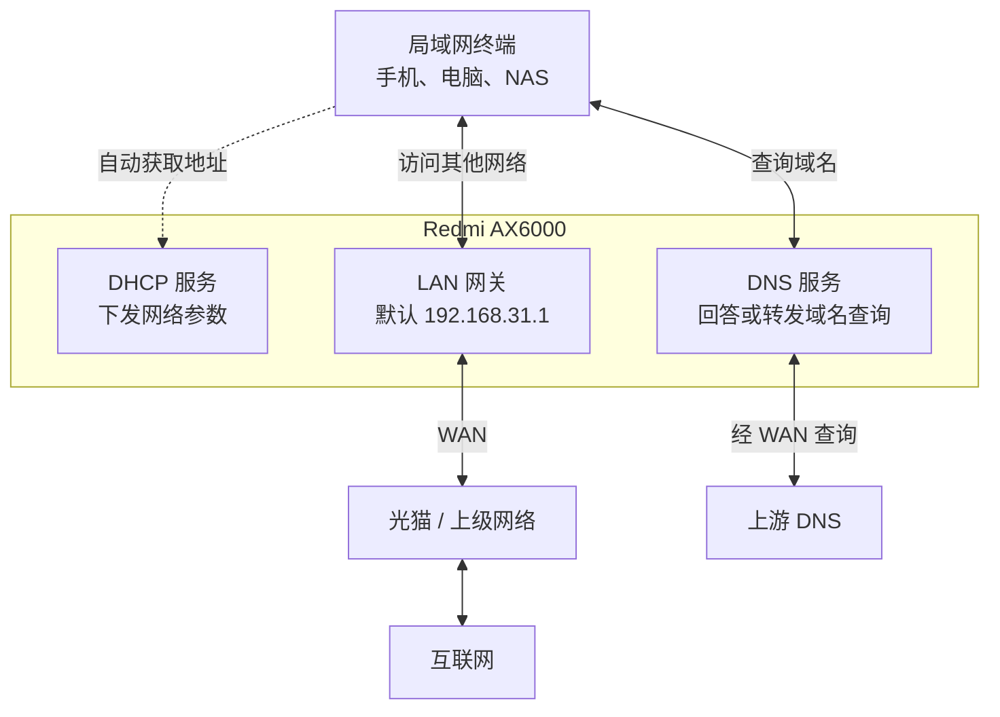
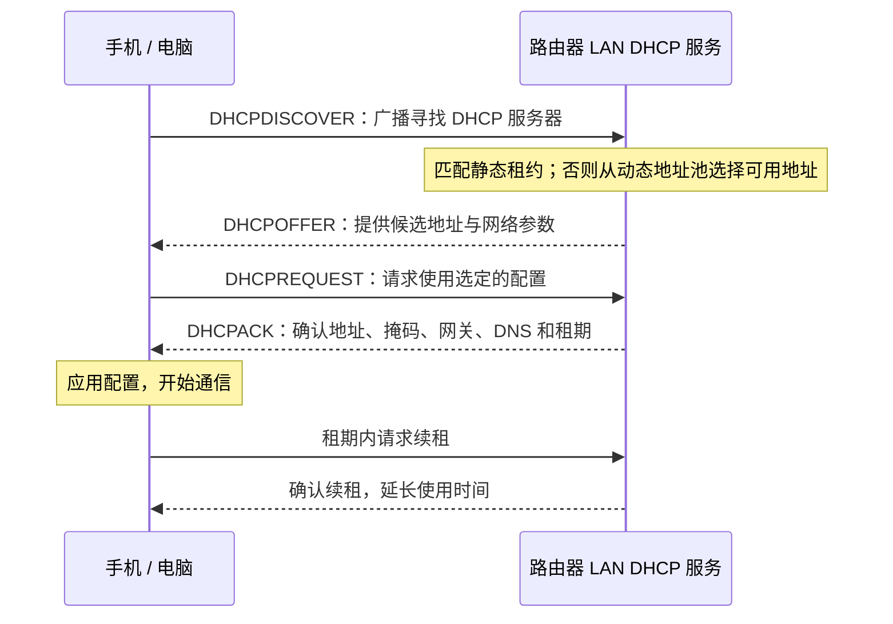

# 局域网、DHCP 与固定地址

[返回首页](../../README.md) · [功能教程](README.md) · [DNS 设置](dns.md#ordinary-dns)

手机连上 Wi-Fi、电脑插上网线后，还需要一组网络参数才能通信：自己的 IP 地址、子网掩码、默认网关和 DNS 服务器。通常由路由器的 DHCP 服务一次下发；需要让 NAS、打印机等设备长期使用同一地址时，再设置静态租约。

本页适用于三条系统线的 IPv4 局域网。首次使用的 LAN 管理地址为 `192.168.31.1`，LAN IPv6 默认关闭；保留配置升级时继续使用原有的管理地址和网络设置。下面出现的终端地址与地址池均为示例，设置时按自己的网络调整。

[认识局域网](#lan-basics) · [DHCP 怎么分配地址](#dhcp) · [给设备固定地址](#fixed-address) · [修改 LAN 网段](#change-subnet) · [连接问题排查](#troubleshooting)

## 认识局域网里的几个角色

LAN 是家里的局域网，连接手机、电脑、NAS、打印机等设备。WAN 是路由器连接光猫、上级路由器或运营商网络的一侧。同一台路由器可以同时承担网关、DHCP 和 DNS 服务，但它们解决的是不同问题。

| 名称 | 作用 | 示例 |
|---|---|---|
| 终端 IP 地址 | 标识终端在这个 IP 网络中的地址；同一局域网内不能让两台设备同时使用同一个 IPv4 地址 | NAS 使用 `192.168.31.20` |
| 子网掩码 | 与 IP 地址一起确定哪些地址属于同一网段 | `255.255.255.0`，也写作 `/24` |
| LAN 地址 | 路由器在局域网这一侧的地址，也是通常访问管理页面的地址 | 默认 `192.168.31.1` |
| 默认网关 | 终端访问其他网络时，把数据交给谁继续转发 | 通常填写路由器的 LAN 地址 |
| DNS 服务器 | 把网站、服务等名称解析成 IP 地址 | 默认向终端提供路由器的 LAN 地址 |
| MAC 地址 | 标识当前连接所使用的网络接口，局域网内传送数据和匹配设备时会用到 | 同一台电脑的有线网卡与 Wi-Fi 网卡通常有不同的 MAC |

例如，NAS 为 `192.168.31.20/24`，电脑为 `192.168.31.120/24`，两者属于 `192.168.31.0/24`，可在局域网内直接通信。电脑访问这个网段以外的地址时，通常先交给默认网关 `192.168.31.1`。在这个 `/24` 示例中，`.0` 是网络地址、`.255` 是广播地址，不分配给终端；`.1` 已由路由器使用，也不能再分给 NAS。

网关和 DNS 经常都是 `192.168.31.1`，是因为路由器同时提供这两项服务。改变 DNS 是改变“去哪里查询名字”，改变网关则是改变“数据交给谁转发”。DNS 设置错误时可能仍能访问已知 IP；网关错误时，即使能查出网站 IP，也可能无法连接网站。

### 常用设置入口

| 要调整的内容 | 入口 |
|---|---|
| 路由器的 LAN 地址与掩码 | **网络 → 接口 → LAN → 编辑 → 基本设置** |
| LAN 的 DHCP 地址池、租期与下发选项 | **网络 → 接口 → LAN → 编辑 → DHCP 服务器** |
| 25.12 的静态租约 | **网络 → DHCP**，在静态租约区域编辑 |
| 21.02、24.10 的静态租约 | **网络 → DHCP/DNS → 静态租约** |
| 路由器使用的普通上游 DNS | 上网接口的高级设置，详见 [DNS 设置](dns.md#ordinary-dns) |

## DHCP 怎么分配地址

DHCP 让终端自动获得网络参数。电脑和手机使用“自动获取 IP”时，会向所在局域网的 DHCP 服务器申请配置。路由器把一个地址租给终端，并同时提供掩码、网关、DNS 和租期。

### LAN 的服务端与 WAN 的客户端

| 位置 | 谁申请、谁分配 | 获得的参数用于哪里 |
|---|---|---|
| LAN DHCP 服务 | 手机、电脑等终端申请，Redmi AX6000 分配 | 终端在家中局域网的连接 |
| WAN DHCP 客户端 | Redmi AX6000 申请，光猫或上级路由器分配 | 路由器连接上级网络 |

这两处 DHCP 各自工作在不同一侧。WAN 选择“DHCP 客户端”，并不会关闭 LAN 的 DHCP 服务；WAN 使用 PPPoE 拨号时，手机和电脑仍可通过 LAN DHCP 获取地址。需要给 NAS 固定局域网地址，应修改 LAN 的静态租约，无需改变 WAN 的上网协议。

### 一次新的地址申请

这是初次申请的典型流程，协议名称对应 [DHCP 规范中的地址分配过程](https://www.rfc-editor.org/rfc/rfc2131#section-3.1)。终端重新连接时可能先请求继续使用原有地址，不一定每次都从第一步开始。

“租约”是一段时间内的地址使用安排。终端通常会在租约到期前自动续租；续租成功可以继续使用同一地址。动态分配也常常拿到之前的地址，但需要长期按地址访问的设备仍应设置静态租约。

租约列表展示已分配或预留的地址：设备断开后，原租约可能尚未到期；静态租约作为配置会一直保留，设备离线时也能编辑。判断设备是否在线，应结合连接状态和实际访问结果。

### 地址池与租期怎么理解

动态地址池规定“可以自动分给普通终端的地址范围”。在 `/24` 网段中，LuCI 的 **起始地址** 是相对于网络地址的偏移，**客户数** 是最多可分配多少个动态地址，并非结束地址。

例如，在 `192.168.31.0/24` 中填写起始地址 `100`、客户数 `100`，表示动态池为 `192.168.31.100` 至 `192.168.31.199`。

- 地址池要位于 LAN 网段内，并避开路由器地址、网络地址和广播地址。
- 给终端手动填写的地址应从动态池中排除，防止 DHCP 又将它分给别的设备。
- 租期较短时，终端会更频繁地续租；修改租期不会立刻让所有在线设备更换地址。
- 地址不够用时，先检查池的范围和仍占用地址的租约，再根据实际设备数量调整。

### DHCP 下发的 DNS 与路由器上游 DNS

这两个设置位于查询链的不同位置：

| 设置 | 决定什么 | 常见用法 |
|---|---|---|
| DHCP 向终端下发的 DNS | 手机、电脑把普通 DNS 查询发给谁 | 默认下发路由器的 LAN 地址 |
| 路由器的上游 DNS | 路由器需要向外查询时使用哪台服务器 | 从 WAN/WAN6 获取，或按需手动填写 |

默认情况下，终端把路由器当作 DNS 服务器。路由器能直接回答的本地记录或缓存会直接返回，其余查询再交给上游。因此，要为全家更换上游 DNS，通常只需按 [普通 DNS 设置](dns.md#ordinary-dns)修改路由器上游，终端继续自动获取 DNS 即可。

如果家中另有一台专门提供 DNS 的设备，例如地址为 `192.168.31.53` 的服务器，可在 **LAN → DHCP 服务器** 设置中找到 **DHCP 选项**，填写 `6,192.168.31.53`，让使用 DHCP 的终端收到这个 DNS 地址。`6` 是 [DHCP 的 DNS 服务器选项编号](https://www.rfc-editor.org/rfc/rfc2132#section-3.8)，后面填写服务器 IP，不是 DoH 网址。先给这台 DNS 设备固定地址，并确认它能正常响应局域网查询。

保存后，让终端重新获取租约，再查看终端显示的 DNS 地址。恢复默认时，删除自己添加的 DNS 选项并重新获取租约；其他 DHCP 选项按原用途保留。终端手动设置的 DNS、浏览器安全 DNS，以及已启用的 DNS 重定向或代理也会影响实际查询路径，相关配置见 [DNS 教程](dns.md#ordinary-dns)。

## 给设备固定地址

NAS、打印机或需要被其他设备长期访问的服务适合使用固定地址。对支持 DHCP 的设备，通常优先使用静态租约：地址由路由器统一管理，终端仍保持自动获取网络参数。

### 四种方式的区别

| 方式 | 地址由谁设置 | 终端怎样设置 | 作用与适用场景 |
|---|---|---|---|
| 动态 DHCP 租约 | 路由器从地址池选择 | 自动获取 IP 和 DNS | 普通手机、电脑日常接入；地址可能变化 |
| DHCP 静态租约 | 路由器为指定设备保留指定地址 | 仍然自动获取 IP 和 DNS | NAS、打印机等需要长期固定地址的设备 |
| 终端手动 IP | 在终端本机填写 | 手动填写 IP、掩码、网关和 DNS | 不便使用 DHCP 的设备；需要自行管理地址占用和后续变更 |
| ARP 绑定 | 在路由器上固定 IP 与 MAC 的邻居映射 | 地址仍需通过 DHCP 或手动配置获得 | 需要固定路由器向某个 IPv4 邻居发送数据时使用的 MAC |

### 设置 DHCP 静态租约

下面以给 NAS 分配 `192.168.31.20` 为例：

1. 让 NAS 连接当前 LAN，并在 NAS 上选择自动获取 IP 和 DNS。
2. 在路由器的设备信息或租约列表中，确认 NAS **当前连接接口的 MAC 地址**。有线和 Wi-Fi 要分开辨认；也可在 NAS 本机查看后手动填写。
3. 打开对应系统的静态租约入口，新增或编辑记录，填写名称、MAC 地址和 IPv4 地址 `192.168.31.20`。名称用于辨认设备，地址必须与当前 LAN 同网段，且未被其他设备占用。
4. 点击 **保存并应用**。让 NAS 重新获取 DHCP 租约，例如断开后重新连接网络，或使用其网络设置中的续租功能。
5. 在 NAS 本机确认实际 IP、掩码、网关和 DNS，再从另一台局域网设备访问新地址。若有使用旧 IP 的书签、共享路径或管理应用，一并更新。

静态租约地址可以位于动态池内，也可以位于同一 LAN 网段的动态池外。为便于整理，可给固定设备预留一段地址，再把普通终端放入另一段动态池；每个地址都应有明确用途，不能重复分配。[dnsmasq 的静态地址规则](https://thekelleys.org.uk/dnsmasq/docs/dnsmasq-man.html)允许静态地址位于动态池外，但要求属于相应 DHCP 网段。

手机的“私有 Wi-Fi 地址”或“随机 MAC”会影响租约匹配。为手机保留地址时，使用它在当前 Wi-Fi 网络上实际采用的 MAC；以后该 MAC 发生变化，需要更新静态租约。无需为了所有设备的普通上网而统一关闭私有地址。

新增静态租约不会立即改写终端正在使用的旧地址。如果新地址仍由另一台设备使用，先解决占用再应用，不能仅靠填写静态租约抢回地址。

### 需要在终端手动填写 IP 时

以当前 LAN 为 `192.168.31.1/24`、计划给设备使用 `192.168.31.20` 为例：

| 终端字段 | 示例填写 |
|---|---|
| IPv4 地址 | `192.168.31.20`，先确认未被占用并已从动态池排除 |
| 子网掩码 / 前缀长度 | `255.255.255.0` / `24` |
| 默认网关 | `192.168.31.1` |
| DNS 服务器 | `192.168.31.1`，或自己已配置好的其他 DNS |

手动 IP 不再由 DHCP 分配。以后更换 LAN 网段、网关或 DNS 时，需要到这台设备上同步修改；路由器新增静态租约也不会覆盖它本机的手动设置。恢复自动管理时，把终端的 IP 和 DNS 都改回自动获取。

### ARP 绑定解决什么问题

IPv4 数据在局域网内发送时，需要知道下一跳 IP 对应的 MAC。通常通过 [ARP 地址解析](https://www.rfc-editor.org/rfc/rfc826)学习这一映射；ARP 绑定把路由器上指定的 IP 与 MAC 映射固定下来。

例如，把 `192.168.31.20` 绑定到 NAS 的 MAC，是让路由器向这个 IP 发送数据时使用指定的 MAC。NAS 自身仍须先通过静态租约或手动设置获得 `192.168.31.20`。如果 NAS 实际使用另一个地址，单独添加 ARP 绑定不会改变它的 IP。

静态租约和 ARP 绑定分别管理“给设备哪个地址”与“向这个地址使用哪个 MAC”，可以配合使用。只想让设备地址稳定时，设置静态租约即可。更换网卡、改用 Wi-Fi、改变私有 MAC 或修改固定 IP 后，已有 ARP 绑定也要对应更新；错误映射可能让路由器把数据发向旧设备。网络安全仍需配置密码、设备认证或访问控制。

## 修改 LAN 网段

常见原因是 LAN 与 WAN 上级网络用了相同网段。例如光猫向 WAN 分配了 `192.168.31.x/24`，而 LAN 也使用 `192.168.31.0/24`，路由器难以按预期区分两侧。此时可把 LAN 改到另一个未被使用、也不与需要访问的远端网络重叠的私有网段。

下面以 **从 `192.168.31.1/24` 改为 `192.168.50.1/24`** 为例。应用时局域网连接会短暂中断，管理地址也会改变；建议使用网线连接 LAN，并先记录旧设置和新地址。

1. **整理会受影响的固定地址。** 查看静态租约、ARP 绑定、手动 IP 设备，以及按 IP 填写的打印机、NAS、转发或访问规则。计划将这些地址一同改到新网段。
2. **修改 LAN 地址。** 进入 **网络 → 接口 → LAN → 编辑 → 基本设置**，把 IPv4 地址改成 `192.168.50.1`，掩码保持 `255.255.255.0`。LAN 继续使用静态地址协议。
3. **检查 DHCP。** 在 LAN 的 **DHCP 服务器** 中保留服务开启，确认地址池落在新网段的有效范围内。起始地址和客户数通常仍按偏移计算，但手动填写的网关、DNS 等完整 IP 必须逐项更新；没有自定义这些选项时，默认网关和 DNS 随 LAN 地址提供。
4. **更新静态记录并应用。** LAN 与 DHCP 修改完成后先点击 **保存**，暂不应用，再到相应页面把静态租约和 ARP 绑定改到新网段，例如 NAS 改为 `192.168.50.20`。保存这些记录，确认待应用的修改后执行 **保存并应用**。
5. **让终端重新获取地址。** 断开后重新连接网线或 Wi-Fi，或执行 DHCP 续租。电脑应获得 `192.168.50.x`，网关应变为 `192.168.50.1`；手动 IP 的设备则要在本机修改。
6. **使用新管理地址。** 浏览器打开 `http://192.168.50.1`，按页面提示完成连接确认，再检查上网、局域网服务和依赖固定 IP 的设置。

保存后旧的 `192.168.31.1` 页面可能断开，这是管理地址变化的结果。若新地址打不开，先查看电脑当前 IP 和网关，不要连续重复提交；页面若因未确认连接而回滚，则回到旧地址检查配置后再操作。

如果电脑一直没有拿到新地址，可暂时给电脑设置一个新网段内未被占用的手动地址，例如 `192.168.50.10/24`，直接打开 `192.168.50.1` 检查 LAN 与 DHCP 设置。恢复 DHCP 后，将电脑改回自动获取，避免把临时手动地址遗留为后续冲突来源。

## 按层排查连接问题

先确定问题是“没连上”“没拿到地址”“到不了网关”“出不了 WAN”还是“域名查不到”。按这个顺序检查，比同时改 IP、DNS 和 WAN 协议更容易定位。

| 检查层次 | 看到什么 | 下一步 |
|---|---|---|
| 网线或 Wi-Fi | 没有连接、连到错误 Wi-Fi，或网线接到了 WAN | 先确认连接的接口、网络名称和物理链路 |
| 地址获取 | 没有 IPv4，或出现 `169.254.x.x` 的链路本地地址 | 检查自动获取设置、LAN DHCP 是否开启、地址池是否还有可用地址；重新获取租约 |
| 网段与冲突 | IP 不属于当前 LAN；提示地址冲突；有时能用、有时不能用 | 检查旧手动 IP、重复静态租约和其他设备占用；确认没有第二台设备在同一 LAN 意外提供 DHCP |
| 网关访问 | 无法打开路由器的当前 LAN 地址 | 核对掩码与网关；若设置了 ARP 绑定，检查 IP、MAC 和连接接口是否仍匹配 |
| WAN 上网 | 能打开管理页面，但局域网设备都无法访问外网 | 查看 WAN 是否已连接、地址与网关是否正常，检查上网协议和 LAN/WAN 网段重叠 |
| DNS 解析 | 能访问已知服务 IP，但域名查询失败 | 查看终端实际 DNS，分别检查路由器 DNS、上游 DNS 和代理接管，参见 [DNS 教程](dns.md#ordinary-dns) |
| 单台设备 | 其他终端正常，只有某一台失败 | 优先检查这台设备的手动设置、私有 MAC、旧租约及对应静态租约 / ARP 绑定 |

### 修改后仍拿到旧地址

先在终端查看当前使用的是有线还是 Wi-Fi，确认修改的租约 MAC 与它一致。然后执行续租或重新连接；若仍不变，检查终端是否手动填写了 IP，以及同一 LAN 内是否还有其他 DHCP 服务器。更换 Wi-Fi 私有 MAC 后，旧记录也不会自动变成新 MAC 的记录。

### 出现地址冲突

找到同时使用该地址的设备，把其中一台改为自动获取或分配另一个已确认空闲的地址。若冲突来自手动 IP 与动态池重叠，调整地址规划后重新获取租约；若静态租约或 ARP 绑定写错，修正对应记录。关掉其中一台只能暂时掩盖冲突，重新上线仍可能复发。

### 在电脑上查看实际收到的参数

Windows 可在网络详情中查看，也可运行 `ipconfig /all`，重点看当前网卡的 IPv4 地址、子网掩码、默认网关、DHCP 服务器和 DNS 服务器。手机可在当前 Wi-Fi 的详细信息中查看地址、路由器和 DNS。

需要立即重新获取 DHCP 时，可先断开再连接网络。Windows 也可执行 `ipconfig /release`，再执行 `ipconfig /renew`；这会暂时释放地址并中断连接，远程操作这台电脑时不要直接释放用于远程连接的网卡。

使用 `nslookup example.com` 可以观察一次普通域名查询及其使用的 DNS；也可指定路由器地址进行比较，例如 `nslookup example.com 192.168.31.1`。按当前 LAN 地址替换示例值。浏览器自己的安全 DNS 和网络中的 DNS 重定向仍需在相应设置中检查。

## IPv6 与本页设置的关系

本固件默认关闭 LAN IPv6，WAN IPv6 可独立配置。手动开启 LAN IPv6 后，终端还可能通过路由通告、SLAAC 或 DHCPv6 获得 IPv6 配置；IPv4 静态租约和 ARP 绑定不会同时固定其 IPv6 地址。需要统一终端 DNS 时，也要检查 IPv6 下发的 DNS，具体关系见 [DNS 设置](dns.md#ordinary-dns)。
